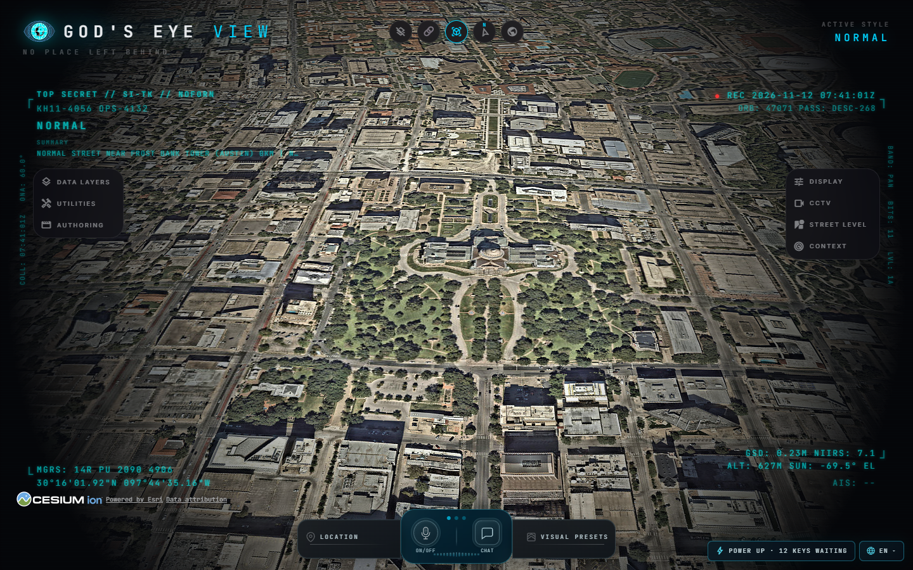

# Windows validation record

Date: 12 November 2026 (Asia/Calcutta). Repository: `F:\OSINT project\gods-eye-view`.

## Provenance and environment

- Original clone: `202cb8c3dcf88d101398d74bc684385b74b9da30`.
- Fast-forwarded to fork/upstream `10a788db78f0657e2eb5f8cdd830e6417aed354d` after two additional upstream commits arrived during setup. This includes the news picture-card height fix.
- 3,730 upstream commits reachable from the final base; all 30 upstream branches and five tags fetched. No shallow clone or sparse checkout.
- Windows x64; portable Node **24.22.3**, npm **11.19.1**; system Node **18.18.0** left unchanged.
- Locked dependencies installed locally. Vite lockfile updated from **6.4.4** to **6.4.6** to address its reported filesystem-deny bypass advisory.
- GitHub fork: <https://github.com/VineetBESTMAN/gods-eye-view> (public, matching the public upstream).
- `origin` points to the user's fork; `upstream` retains the original repository.

## Verification results

| Check | Result and scope |
| --- | --- |
| Dependency installation | Passed: `npm ci`, 223 packages installed |
| Setup doctor | Passed: supported Node/npm, dependencies present, keyless map route ready |
| Initial format check | Passed: 2,001 source files checked |
| Initial package boundaries | Passed: 1,272 modules / 92 portable entries and package export groups |
| Original upstream unit invocation | Failed before tests on Windows with `ENAMETOOLONG`; fixed by batching filenames |
| Full batched unit run | 12,626 tests: 12,611 passed, 13 skipped by upstream conditions, 2 timing failures under concurrent build/browser load; process exited nonzero |
| Isolated rerun of both failed files plus runner regression | Passed: 115 tests, zero failures. No deadlines or assertions were relaxed |
| Allocation checks | Passed: 15 tests, zero failures, using Node 24 and explicit GC |
| Initial production build | Passed: 1,209 modules transformed; generated `dist/`. Upstream large-chunk warnings remain |
| Real keyless browser startup | Passed: HTTP 200, Cesium scene mode 3, 1440×900 canvas, one imagery layer, tiles loaded, zero uncaught JavaScript errors |
| Initial tracking regression | 110 passed, 1 failed, 0 skipped. Military arrival observation took 515.2 ms against a 500 ms deadline while other checks were running |
| Final isolated tracking regression | **111 passed, 0 failed, 0 skipped**, including arrival rotation, with zero console errors and zero HTTP 5xx responses |
| Final source checks | Formatting and all package-boundary checks passed on the final source |
| Final focused tests | **30/30 passed**: updated upstream news layer and Windows test-runner regression |
| Final production build | Passed with **Vite 6.4.6**, 1,209 modules transformed, build completed in 19.52 seconds |
| Final Windows smoke check | Passed after copying the PNG again: server stayed running, tiles loaded, zero uncaught browser errors |

One intermediate browser rerun was invalidated when Windows' native file watcher threw `EBUSY` as a documentation PNG was copied, terminating the dev server. The Windows launcher now sets `CHOKIDAR_USEPOLLING=true` and a 1,000 ms interval. The final 111/111 run used this launcher and Vite 6.4.6. Its evidence is `.gev-logs/tracking-polling.log`; the interrupted run remains in `.gev-logs/tracking-final.log` rather than being reported as a pass.

The full unit run was not a clean all-green run. The two failures were independently reproduced as passing under isolated execution; this supports resource contention as the explanation but is not a substitute for reporting the original nonzero result. The full suite's platform/environment skips are preserved rather than counted as passes.

## Dependency audit

After updating Vite, `npm audit --omit=dev` reports **zero vulnerabilities** in production dependencies. The complete audit still reports **7 findings: 5 moderate and 2 high**, in development/test dependency chains:

- `happy-dom` and `@happy-dom/global-registrator`: high; the suggested remediation changes their major version.
- `@vue/test-utils`, `js-beautify`, `glob`, `editorconfig`, `minimatch`: moderate transitive/test-tool findings; npm proposes an out-of-range change to test-utils.

These remain in the inherited test toolchain. No force-upgrade was applied, and the repository is not claimed to be audit-clean. Audit results are time-dependent; rerun the audit when maintaining the project.

## Local evidence

Inspected keyless startup on this PC (Esri imagery; no Google photorealistic key):

Logs and screenshots are kept locally and excluded from Git, because generated test logs may contain provider URLs or future credentials:

- `.gev-logs/validation.log`: initial doctor, format, boundaries and original command-length failure.
- `.gev-logs/unit-tests.log`: complete batched unit run, including both timing failures and upstream skips.
- `.gev-logs/isolated-tests.log`: 115 passing isolated tests.
- `.gev-logs/allocation-tests.log`: 15 passing allocation checks.
- `.gev-logs/build.log`: initial build output.
- `.gev-logs/format-final.log`, `boundaries-final.log`, `focused-final.log`, `build-final.log`, `smoke-final.log`: final source checks, 30 focused tests, patched production build and keyless startup confirmation.
- `.gev-logs/tracking.log`: initial browser regression.
- `.gev-logs/tracking-final.log`: intermediate run interrupted by the native file-watcher crash.
- `.gev-logs/tracking-polling.log`: final 111/111 passing regression with polling enabled.
- `.gev-logs/audit-final.json`, `.gev-logs/audit-production.json`: final audit reports.
- `qa-artifacts/local-smoke/globe.png`, `report.json`: inspected screenshot and structured keyless browser result; the reviewed screenshot is also committed under `docs/local-setup/windows-keyless.png`.
- `.gev-logs/server-final.log`, `server-final-error.log`: current server logs; `server-patched-error.log` preserves the earlier watcher crash.

## Scope limits

The browser automation uses Chromium with software rendering. The keyless globe screenshot was inspected, but interactive performance on the PC's physical GPU was not benchmarked. Tracking regressions use synthetic feeds and bundled map imagery; they validate application behavior, not the completeness or uptime of real-world data. Paid/provider-key features were not tested without the user's credentials. Voice, Google photorealistic tiles, vessels and other optional integrations therefore remain configuration-dependent.

This delivery includes the full source and bundled assets, local dependency installation, production build, launchers, documentation and test evidence. It does not include private upstream credentials, unbundled third-party datasets, paid API access, GitHub issue/PR discussions, or a guarantee of live-provider availability.
