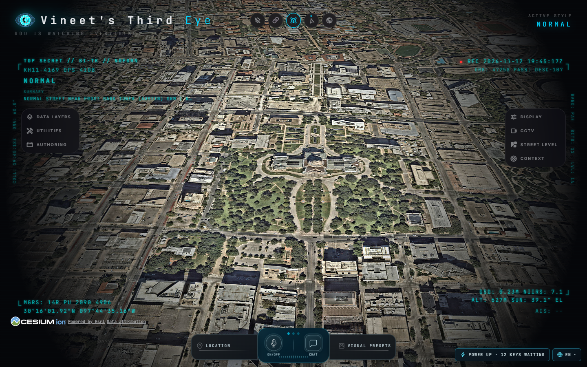

# Vineet's Third Eye

**GOD IS WATCHING EVERYTHING**

[](https://github.com/VineetBESTMAN/Vineets-Third-Eye/actions/workflows/ci.yml)

A local spatial intelligence dashboard for exploring aircraft, ships, satellites and public geospatial data on an interactive 3D globe. Built for exploration, visual analysis and learning, with source code and configuration you control.

[Get started](#get-started) · [Operator guide](HOW-TO-USE.md) · [Data sources](DATA_SOURCES.md) · [Contribute](CONTRIBUTING.md) · [Issues](https://github.com/VineetBESTMAN/Vineets-Third-Eye/issues)



## Explore the world

| Capability | What you can explore |
| --- | --- |
| Aircraft | Public flight telemetry, civilian and military layers, trails, contact cards and cockpit perspectives |
| Ships | AIS vessel positions, identities, movement and trails with your AISStream credentials |
| Satellites | Public orbital data, calculated positions, tracks and filters for stations, imaging, telecom, Starlink, probes and debris |
| Environment | Earthquakes, weather, fires and imagery layers, depending on provider availability and configuration |
| Places and infrastructure | Search, local datasets, transport, infrastructure and public camera coverage |
| Visual tools | Sensor styles, display controls, annotations, shareable views and scene authoring |
| Optional voice | Voice and AI features through a configured supported provider |

The globe combines different kinds of evidence. Aircraft and ship reports depend on source coverage and freshness. Satellite positions are calculated from orbital elements. Traffic can be simulated. Basemap imagery and satellite markers are not a live overhead video feed.

### Additional exploration tools

- **Rail:** configured from 30 keyless operator feeds: live GPS positions from 29 of them and Irish Rail’s station reports, 28 live out of the box. These are the registry's supported routes, not a guarantee that every provider is currently online. Some feeds need local schedule packs; see the data-source inventory.
- UTILITIES ▸ **Draw** lets you sketch areas and routes on the globe and manage them with the scene tools.
- **Sits on the real ground.** Entity heights are aligned to work with Google 3D tiles, so aircraft park on aprons and cameras stand on street corners instead of floating.

## Get started

### Windows

```powershell
git clone https://github.com/VineetBESTMAN/Vineets-Third-Eye.git
cd Vineets-Third-Eye
.\setup-windows.cmd
.\start-windows.cmd
```

Open **[http://localhost:4173](http://localhost:4173)** and choose **Explore Manually** or a first-run mission. Expand **DATA LAYERS** to enable a feed; use **LOCATION** to move to a city, airport or coordinates.

The setup launcher installs checksum-verified portable Node 24.22.3 and the locked dependencies without replacing your system Node. Startup binds to localhost and uses Windows-compatible file watching. The existing installation on Vineet's PC remains at `F:\OSINT project\gods-eye-view`; its launchers continue to work.

See [LOCAL-WINDOWS.md](LOCAL-WINDOWS.md) for setup, maintenance and troubleshooting.

### Other supported Node environments

Use Node 24.14 or later within 24.x, or Node 26.x, as specified in `package.json`.

```sh
git clone https://github.com/VineetBESTMAN/Vineets-Third-Eye.git
cd Vineets-Third-Eye
npm ci
npm run doctor
npm run dev
```

For Docker, the included `compose.yaml` builds locally and publishes port 4173 on loopback:

```sh
docker compose up --build
```

Internet access and a WebGL-capable browser are needed for the normal globe experience. This is a local application, not a fully offline copy of all provider data.

## Configure data providers

Start with the keyless globe and public feeds. Use **POWER UP → Provider Settings** to add optional credentials, then **SAVE KEYS**. If the button is hidden, open [the setup panel](http://localhost:4173/?setup=1).

| Provider / capability | Configuration |
| --- | --- |
| Keyless globe, public aircraft and satellite feeds | No personal key needed for the supported anonymous routes; coverage and rate limits apply |
| Live vessels | `AISSTREAM_API_KEY` |
| NASA FIRMS fires | `FIRMS_MAP_KEY` |
| Google / Cesium mapping | Configure the corresponding Google key or Cesium token for the selected map route |
| OpenAI voice | Configure the supported voice provider in the app |
| TomTom / Mapillary | Optional provider credentials |

Use [.env.example](.env.example) for the complete settings reference. Store real keys only in ignored local configuration, never in a commit. Provider terms, quotas and billing are controlled by the providers.

## Development and checks

On this Windows installation:

```powershell
powershell -NoProfile -ExecutionPolicy Bypass -File .\scripts\windows.ps1 -Action Doctor
powershell -NoProfile -ExecutionPolicy Bypass -File .\scripts\windows.ps1 -Action Build
powershell -NoProfile -ExecutionPolicy Bypass -File .\scripts\windows.ps1 -Action Test
```

With a supported Node version on PATH:

```sh
npm run format:check
npm run check:boundaries
npm test
npm run build
```

Run `npm run test:track -- --offline-imagery` with the local server running for the synthetic browser tracking regression. See [TESTING.md](TESTING.md) and [LOCAL-VALIDATION.md](LOCAL-VALIDATION.md) for test scope and recorded results. The CI badge reports the actual state of `main`; opening a fix PR does not make `main` green until the fix is merged and checked.

## Repository workflow

This is an independent repository with a fresh initial history. Future development happens on `feat/`, `fix/`, `chore/` or `docs/` branches and through pull requests.

`main` requires an up-to-date PR branch and all four required CI checks. Required reviewer approvals are set to zero so Vineet can review and merge his own PRs manually; GitHub does not allow authors to submit approving reviews on their own PRs. Force pushes and deletion are blocked, including for administrators. Merge commits and retained branches keep development history visible. Automated work leaves PRs open until Vineet requests a merge.

See [REPOSITORY-WORKFLOW.md](REPOSITORY-WORKFLOW.md) and [AGENTS.md](AGENTS.md).

## Documentation

- [How to use flights, ships and satellites](HOW-TO-USE.md)
- [Windows installation and operation](LOCAL-WINDOWS.md)
- [Data-source inventory](DATA_SOURCES.md)
- [Architecture and application composition](docs/APPLICATION.md)
- [MCP setup](docs/MCP_SETUP.md)
- [Security and private reporting](SECURITY.md)
- [Contribution guide](CONTRIBUTING.md)

## Maintainer and licensing

Maintained by [Vineet Madan](https://github.com/VineetBESTMAN).

Source code is licensed under [MIT](LICENSE). This product incorporates an existing open-source codebase; original copyright and contributor attribution are preserved in [SOURCE-ATTRIBUTION.md](SOURCE-ATTRIBUTION.md). Bundled datasets, models and other assets have their own terms: see [THIRD_PARTY_NOTICES.md](THIRD_PARTY_NOTICES.md) and [DATA_SOURCES.md](DATA_SOURCES.md).
